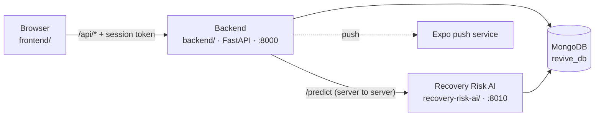

# RE:VIVE — Project Structure

How the repository is laid out, how the parts talk to each other, and where to
look when you want to change something. For what the product does and how to
run it, start with the [README](../README.md).

---

## The three parts



- **Backend** (`backend/`) is the only thing the browser talks to. It serves the
  frontend's files, the JSON API under `/api`, and checks the session and role on
  every request.
- **Frontend** (`frontend/`) is a single-page app in plain JavaScript. There is no
  build step: the backend serves the files as they are.
- **Recovery Risk AI** (`recovery-risk-ai/`) is a separate prototype service. The
  browser never calls it. The backend forwards requests to it through
  `/api/ai/predict`, so every prediction carries a signed-in session. Its routes
  have no authentication of their own, so it must stay bound to `127.0.0.1`.

---

## Repository layout

```
Re-Vive/
├── README.md
├── docs/
│   └── structure.md                 # This file
│
├── backend/
│   ├── requirements.txt             # Pinned dependencies
│   ├── .env.example                 # Copy to .env; every setting is documented there
│   ├── seed_data.py                 # Demo data: 5 hospitals, doctors, patients, guardians
│   └── app/
│       ├── main.py                  # App factory, startup (DB, admin seed, scheduler), static files
│       ├── config.py                # Settings, read from backend/.env as UTF-8
│       ├── database.py              # Motor client and every index
│       ├── common/                  # Shared engines used by several modules
│       │   ├── recovery.py          # Recovery score, timeline, digital twin
│       │   ├── alerts.py            # Alert triggers, recipients, missed check-in sweep
│       │   ├── patients.py          # Clinical profile, abstinence days, streak, care team
│       │   ├── push.py              # Expo push delivery (best effort)
│       │   ├── scheduler.py         # Background sweep every 15 minutes
│       │   ├── ratelimit.py         # Login and refresh rate limit
│       │   ├── audit.py             # Writes and reads the audit trail
│       │   ├── models.py            # ObjectId conversion and document serialisation
│       │   └── exceptions.py        # 400 / 401 / 403 / 404 / 409 errors
│       ├── auth/                    # Login, refresh-token rotation, role checks
│       ├── admin/                   # Super admin: hospitals and their admin accounts
│       ├── hospital/                # Hospital admin: users, assignments, guardian links
│       ├── doctor/                  # Doctor portal and caseload analytics
│       ├── patient/                 # Check-ins, dashboard, profile
│       ├── guardian/                # Read-only view of the linked patient
│       ├── clinical/                # Medications, vitals, history, interventions, care plans
│       ├── alerts/                  # Alert list and read state
│       ├── appointments/            # Scheduling, scoped by role
│       ├── devices/                 # Push token registration
│       └── ai/                      # Authenticated gateway to the AI service
│
├── frontend/
│   ├── index.html                   # Shell; loads every script in order
│   ├── css/
│   │   ├── base.css                 # Design tokens for both themes, reset, type
│   │   ├── components.css           # Navigation, buttons, cards, tables, modals, toasts
│   │   └── pages.css                # Every screen's layout
│   └── js/
│       ├── api.js                   # Fetch wrapper, silent session renewal
│       ├── theme.js                 # Light / dark / system theme
│       ├── auth.js                  # Welcome page, sign-in, demo accounts
│       ├── components.js            # Navbar, alerts, search, toasts, escaping and date helpers
│       ├── recovery.js              # Score gauge, timeline, digital twin views
│       ├── ai.js                    # Recovery risk card
│       ├── router.js                # Hash router with role guards (loaded last)
│       └── pages/                   # One file per screen, grouped by role
│
├── recovery-risk-ai/
│   ├── service.py                   # The whole service: /health, /predict, /train/from-mongodb
│   ├── requirements.txt             # Exact versions: the model only loads with these
│   ├── .env.example
│   └── model/
│       ├── recovery_risk_model.joblib
│       ├── training_data.csv        # 300 rows of synthetic training data
│       └── generate_training_data.py
│
└── tests/
    ├── test_recovery_and_twin.py    # Score engine and twin maths
    ├── test_mobile_backend.py       # Refresh tokens, push, devices, scheduler
    └── test_session_client.mjs      # Browser session client, against a running server
```

---

## Backend

Each feature module follows the same three files:

| File | Holds |
|---|---|
| `router.py` | Routes, role checks, audit logging |
| `service.py` | Database work and business rules |
| `schemas.py` | Pydantic request and response models |

Rules that span modules live in `app/common/` so they exist once. The main ones:

- **Who may read a patient's record** is decided in one place,
  `clinical/service.py → resolve_patient_access()`. A doctor needs the patient
  assigned to them, a guardian needs them linked, a hospital admin needs them in
  their hospital, and a patient may read only their own record.
- **The recovery score** (`common/recovery.py`) is computed on request from the
  last 30 days of check-ins and never stored, so it cannot drift from the data
  behind it. The digital twin reuses the same formula.
- **Alerts** (`common/alerts.py`) are created by check-ins, appointments and the
  missed check-in sweep, and are sent to the assigned doctors and the linked
  guardian. Push delivery runs after the alert is saved and cannot fail the
  request that raised it.

### Startup

`main.py` warns if the secret key or admin password is still a published
default, connects to MongoDB and creates indexes, makes sure the admin account
from `.env` exists, and starts the missed check-in sweep.

---

## Frontend

`index.html` loads plain scripts in a fixed order: shared modules first,
then every page, then `router.js` last. Each page file defines a global
`render…()` function, and the router calls it for its hash route
(for example `#/doctor/patients`) after checking the signed-in role.

- **Sessions.** `api.js` stores the access and refresh tokens. When a request
  gets a 401, it renews the session once and replays the request. Only one
  renewal runs at a time, because refresh tokens rotate and a second concurrent
  renewal would look like token theft and end every session.
- **One header.** `renderNavbar()` in `components.js` draws the header on
  every page. Signed in, it carries the role's pages, patient search, alerts
  and the account button; on the welcome and sign-in pages it keeps the same
  brand and theme switch with a single action.
- **Responsive.** Below 1100px the page links move to a second header row;
  below 900px stat cards go two by two; below 768px modals open as bottom
  sheets; below 640px every data table becomes stacked, labelled rows (the
  labels are copied from the column headers automatically). Headings wrap
  long unbroken names and emails instead of widening the page.
- **Themes.** Light (warm white) and dark (charcoal) share one clinical red
  identity. Every colour is a token in `base.css`, including the composed
  surfaces such as the doctor hero and quick-actions rail, so both themes and
  the system setting stay in step. An inline script in `index.html` applies the
  saved theme before the stylesheets load, so a page never flashes the wrong
  theme.
- **User text.** Anything a person typed (names, notes, alert messages) goes
  through `escapeHtml()` from `components.js` before it is put into the page,
  and only IDs are ever passed through inline `onclick` handlers.

---

## Recovery Risk AI

A prototype that estimates LOW / MEDIUM / HIGH recovery risk with XGBoost and
explains each estimate with SHAP feature contributions.

> [!IMPORTANT]
> The included model is trained on **300 rows of synthetic data**
> (`model/training_data.csv`). Its inputs were designed around
> post-procedure recovery (pain, temperature, oxygen saturation) and most of
> them are not collected by RE:VIVE, so the app sends them empty and the model
> fills them with training medians. Treat its output as a demonstration of the
> plumbing, not as a meaningful risk score.

**Running it**

```bash
cd recovery-risk-ai
python -m venv venv
venv\Scripts\activate            # Windows
# source venv/bin/activate       # macOS / Linux
pip install -r requirements.txt
cp .env.example .env
uvicorn service:app --host 127.0.0.1 --port 8010
```

The backend finds it through `AI_SERVICE_URL` in `backend/.env`
(default `http://127.0.0.1:8010`). If it isn't running, the risk cards say so
and everything else works.

**Retraining**

The `.joblib` model loads reliably only with the exact library versions in
`requirements.txt`. If you change them, retrain it:

1. Load `model/training_data.csv` into the collection named by
   `MONGO_COLLECTION` (default `revive_db.recovery_risk_data`), for example
   with `mongoimport` from the MongoDB Database Tools:

   ```bash
   mongoimport --db revive_db --collection recovery_risk_data \
     --type csv --headerline --file model/training_data.csv
   ```

2. With the service running, `POST /train/from-mongodb`. This overwrites the
   model file and returns accuracy, precision, recall, F1 and ROC AUC on a
   held-out 20%.

`model/generate_training_data.py` regenerates the CSV with a fixed seed.

---

## Database

MongoDB database `revive_db`. Every index is created at startup in
`backend/app/database.py`. API responses return `_id` as a string `id`.

| Collection | Holds | Notes |
|---|---|---|
| `users` | Every account, all five roles | Doctors carry `assigned_patients`; guardians carry `linked_patient_id`. Unique `email`. |
| `hospitals` | Hospitals and their admin account | Unique `email` |
| `patient_profiles` | Condition, programme, sobriety date, emergency contact | One per patient. Abstinence days are computed, not stored. |
| `daily_checkins` | Mood, craving 1–10, stress 1–10, sleep, medication, activity, notes | One per patient per UTC day |
| `clinical_notes` | Doctor notes: progress, observation, concern | |
| `recovery_goals` | Goals set by the doctor | `not_started` / `in_progress` / `completed` |
| `medications` | Prescriptions | Discontinued, never deleted |
| `vitals` | Blood pressure, heart rate, temperature, weight | |
| `interventions` | What a doctor did, linked to the alert that prompted it | Logging one marks that doctor's copy of the alert read |
| `treatment_plans` | Care plans | Versioned: a new plan supersedes the old one |
| `appointments` | Scheduled, completed or cancelled visits | |
| `alerts` | One document per recipient per alert | Types: `craving_spike`, `stress_spike`, `adherence_drop`, `missed_checkin`, `appointment` |
| `audit_logs` | Who did what, when, from which IP | Readable at platform and hospital scope |
| `refresh_tokens` | Session tokens, stored as SHA-256 hashes | Rotate on use; reuse of a rotated token revokes all of that user's sessions. Expire through a TTL index. |
| `device_tokens` | Expo push tokens | Unique per app install, so a shared phone never keeps the previous user's alerts |
| `recovery_risk_data` | Training rows for the AI service | Used only by `recovery-risk-ai` |

---

## API

82 endpoints, all under `/api`. Interactive documentation with request and
response schemas is served at **`/docs`** while the backend runs.

"Care team" means the assigned doctors, the hospital admin, the linked guardian
and the patient themselves, each limited as described under
[Backend](#backend).

| Group | Endpoints | Who |
|---|---|---|
| `/auth` | `POST login` · `POST refresh` · `POST logout` · `GET me` | Login and refresh are public and rate limited |
| `/admin` | `stats` · `hospitals` (list, create, read, update, `status`) · `hospital-admins` · `hospitals/{id}/admin` (read, update, replace, `password`) · `audit-logs` · `audit-logs/facets` | Super admin |
| `/hospital` | `dashboard` · `users` (list, create, update, `status`) · `patients/{id}/profile` (read, update) · `assignments` (list, create, delete) · `link-guardian` · `unlink-guardian/{id}` · `audit-logs` · `audit-logs/facets` | Hospital admin |
| `/doctor` | `dashboard` · `analytics` · `patients` · `patients/{id}` and its `profile`, `checkins`, `notes`, `goals`, `goals/{goal_id}`, `recovery-score`, `digital-twin` | Doctor, assigned patients only |
| `/patient` | `dashboard` · `checkin` · `checkins` · `goals` · `profile` · `recovery-score` · `digital-twin` | Patient, own record |
| `/guardian` | `dashboard` · `patient` | Guardian, linked patient only |
| `/clinical/patients/{id}` | `medications` · `vitals` · `history` · `timeline` · `recovery-score` · `digital-twin` · `interventions` · `treatment-plan` | Read: care team. Write: doctor. |
| `/appointments` | list · read · `POST` create · `PATCH` update | Create: doctor. Update: doctor or hospital admin; patient and guardian may only cancel. |
| `/alerts` | list · `unread-count` · `read-all` · `{id}/read` | Signed-in user, own alerts |
| `/devices` | register · list · delete | Signed-in user, own devices |
| `/ai` | `health` · `predict` | Any signed-in user |
| `/health` | Liveness check | Public |

---

## Tests

Plain scripts, no test framework. Run them from the repository root, the Python
ones with the backend's virtual environment active. Each prints what it checked
and exits non-zero on the first failure, so they also work in CI.

| Command | Checks | Needs |
|---|---|---|
| `python tests/test_recovery_and_twin.py` | Score maths pinned to a fixed history, twin scenarios, route registration | Nothing. The database is mocked. |
| `python tests/test_mobile_backend.py` | Refresh rotation and reuse detection, push, devices, scheduler | MongoDB. Uses its own throwaway database, drops it afterwards, and ignores the database and scheduler settings in `.env`. |
| `node tests/test_session_client.mjs` | The real `frontend/js/api.js`: silent renewal, single-flight refresh, sign-out | Node 18+ and a seeded backend on `:8000`. Optional arguments: `[base-url] [email] [password]`. |

The session test signs in twice, so running it back to back can trip the login
rate limit (`LOGIN_RATE_LIMIT`, 5 per minute by default); wait a minute and run
it again.
